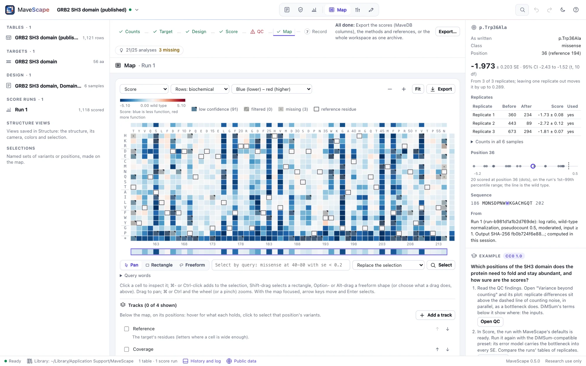

# MaveScape

<picture>
  <source media="(prefers-color-scheme: dark)" srcset="docs/images/map-dark.webp">
  
</picture>

MaveScape is a workbench for multiplexed assays of variant effect (MAVEs), starting with protein
deep mutational scanning. It turns the variant count tables of an experiment into functional
scores with standard errors, quality control that says when not to trust them, and an
interactive variant-effect map, and it keeps every analysis decision on record. It runs on your
own computer as one self-contained program: a single command installs it, and it needs no
account, Python or R. Files are analyzed in your browser and never leave your machine.

It covers the path from a count table to a result you can defend, and checks each step:

- count tables as Enrich2, DiMSum, dms_variants or a lab's own scripts write them, every variant
  name checked against the target;
- designs of every common kind: two populations, time series, sorted bins (sort-seq), tiled and
  barcoded libraries, and conditions selected from a shared input;
- scores equal to Enrich2's, dms_variants' and DiMSum's, with 95% intervals that hold the truth
  94–97% of the time in simulated experiments;
- quality control that finds bottlenecks, dropouts and failing replicates, and says what could
  cause each finding and what to do;
- the variant-effect map, with tracks of domains, conservation, predictors, ClinVar and gnomAD
  beside it;
- comparisons of replicates, conditions, runs, published score sets and predictors, on one scale;
- the scores on the protein's structure, and the structure used as evidence;
- MaveDB: published score sets opened by search, and runs written as deposits MaveDB's own
  validators accept;
- figures for a paper or a talk, drawn from the analysis and exported as SVG, PDF or PNG, each
  carrying what it was drawn from, so it can be checked and rebuilt;
- a record a reviewer can repeat: the methods of the whole workspace with their references,
  provenance, and a workspace archive that reopens identically on another computer.

MaveScape reports experimental functional effects for research. It does not classify variants as
pathogenic or benign. It is free and open source (Apache 2.0).

**[Website and user guide](https://robert-mcdermott.github.io/MaveScape/)**: step-by-step
guides to every view, with screenshots.

- [Highlights](#highlights)
- [What is a MAVE?](#what-is-a-mave)
- [Install](#install)
- [Getting started](#getting-started)
- [Opening data](#opening-data)
- [The views](#the-views)
- [Command-line options](#command-line-options)
- [Scripting and headless runs](#scripting-and-headless-runs)
- [Validation](#validation)
- [Privacy and security](#privacy-and-security)
- [Limitations](#limitations)
- [Development](#development)
- [License, citation and credits](#license-citation-and-credits)

## Highlights

- **Import.**
  - MaveDB, Enrich2, DiMSum and dms_variants layouts recognized; a lab's own table mapped once
    and saved as a template; one file per sample joined into one table.
  - Every variant name checked against the target. The whole of MAVE-HGVS is read, as mavehgvs
    reads it; lab forms such as `A12V` and `_wt` are read leniently and kept as written.
  - A missing count is never read as zero, and every problem that blocks scoring is listed by
    line.
  - Nucleotide variants read for the protein change they make (checked against biocommons hgvs)
    and drawn at the protein level; splice-site, intronic and UTR variants listed beside the map.
  - Targets from FASTA, a GenBank file (a plasmid map or a RefSeq record), or the RefSeq or
    Ensembl transcript a MaveDB record names.
  - A million rows import in a few seconds.
- **Designs.** Drafted from the column names and checked in the Experiment view, where every
  column is accounted for and the design is described in plain words. Read from a sample sheet
  or DiMSum's design file. **What the analysis can do** says which analyses the workspace
  supports, and what the bench or the protocol would add (the cells carried into selection, the
  bins' gates, what the assay measures).
- **Scoring.**
  - Log ratios with wild-type, complete-case, all-read or synonymous normalization.
  - Time series by weighted regression on every time point, per unit of time or per generation.
  - Sorted bins by their weighted average or a censored log-normal maximum-likelihood fit.
  - Barcoded libraries: barcodes summed per variant, or each scored and combined, with outlier
    barcodes found.
  - DiMSum's fitness and error model, computed as DiMSum 1.4 computes it.
  - Replicates combined under a shared error model with moderated dispersions, or by REML, fixed
    effects or Enrich2's own estimator.
  - Conditions compared by limma's moderated t (as mutscan computes it), or by pairs of
    replicates sharing an input.
  - Eight ordered filters, each variant left out with its reason. Enrich2- and
    DiMSum-compatible presets for comparison with published scores.
  - Every run is immutable and kept with everything needed to repeat it.
- **Quality control.** Twelve findings, each pass, review or fail with what was found, its
  threshold, why it matters and the plot behind it: depth, coverage judged against what the
  library can make, dropouts, replicate agreement, outlier replicates, the separation of the
  controls, and variance beyond counting, which points to a bottleneck (DiMSum's error terms
  place it before or after selection). Each finding says what could cause it and what to do.
  Thresholds are kept in the workspace and every change is recorded.
- **The variant-effect map.**
  - Positions across, substitutions down, colored on a scale centered on the wild type.
    Missing, filtered and low-confidence measurements are drawn their own way, never as "no
    effect".
  - Click a cell for its evidence: the score with its interval, each replicate, every sample's
    counts and the sequence around it.
  - Every run, and every difference between conditions, as a map.
  - Tracks beside it: UniProt's domains and secondary structure, conservation (PDBe-KB's
    profile, or your alignment scored as Capra and Singh's tool scores it), AlphaMissense,
    ClinVar, gnomAD, MaveDB's annotations, the structure's classes, and your own files
    (predictors' scores, GFF3, tables), each with its source and date.
  - Selections by click, rectangle, freeform shape or query (`missense at 40-80 with se < 0.2`,
    `from C in feature disulfide`), saved by name, combined and carried to the other views.
  - SVG and PNG export; the map described in words and as a table.
- **Comparison.** Two replicates, conditions or runs, a run against another MaveDB score set
  (kept beside the workspace without opening it), or a predictor (AlphaMissense, EVE, ESM1b):
  - a compatibility report first (targets and coordinates, the variants matched, directions,
    scales, whether the two are independent);
  - Pearson, Spearman, Lin's concordance and Bland–Altman with their 95% intervals, equal to R's;
  - two assays put on one scale by their anchors (nonsense and the wild type), the anchors'
    uncertainty carried into the tests;
  - the two maps and their difference, panned and zoomed as one, and the variants and
    positions that differ beyond their uncertainty;
  - a predictor by rank, and by its classes with an AUC and DeLong's interval.
- **Robustness to analysis choices.** A run scored again across pseudocounts, normalizations,
  models of uncertainty, combinations of replicates, filters and each replicate left out. Each
  variant's conclusion is said to hold under every one, or to depend on a choice, which is named.
- **Protein structure.** The Structure view needs no other program.
  - A PDB entry, an AlphaFold DB model or your own file (PDB, mmCIF, BinaryCIF), drawn with
    WebGPU or a Canvas renderer, with its biological assemblies; the structures that cover the
    target ranked.
  - The target mapped onto every chain that holds it, position by position, as SIFTS maps it.
  - Residues colored by their positions' scores in the map's colors (median, fraction
    abnormal-like, uncertainty, disagreement, QC state); a selection on the map is a selection
    on the structure.
  - What the structure says of each position (DSSP's secondary structure, accessibility,
    exposure and disorder, contacts with partners typed by PLIP's rules) as tracks beside the
    map; the scores compared by structural class, and a test of whether the least tolerant
    positions cluster beyond what burial explains.
  - Views saved with the workspace, its archive and methods; figure panels with their legend.
  - Opened in Proteoscope as its own session, when it runs on your computer.
- **Figures.** A page at a journal's column width (85, 114 or 174 mm) or a slide, its panels any
  view's plots, added with **Add to figure**: the variant-effect map of a run (a range of
  positions, its tracks, color bar and key), a QC finding's charts, the scores by class, a
  comparison, a variant's evidence, a saved structure view, and text; lettered A, B, C… in reading
  order and laid out by dragging, snapping to each other. A panel says what it shows, so the figure follows the
  analysis until it is exported: SVG and PDF as vectors with the text as text, PNG at 300 or 600 dpi
  of the printed size, or the clipboard. Text under 6 pt at the printed size is flagged.
  - Each exported file carries its manifest: what each panel shows, each run by its output's
    SHA-256, the QC thresholds, a digest of each panel's drawing, MaveScape's version, and a
    fingerprint that catches an edit.
  - Dropped on the window, a figure says panel by panel what changed in the workspace since it was
    made, and is rebuilt from its manifest, each panel's drawing compared with the one recorded.
- **Public data.** Any published MaveDB score set opened by search or URN: its record, its
  scores as published and its counts ready to score again. Several score sets of one target open
  together as conditions to compare. A target is checked against its UniProt entry. Public data
  come from a fixed list of services, are cached with where and when they came from, and work
  offline from the cache.
- **The record.**
  - Scores and counts in MaveDB's upload columns, QC per sample and per variant, provenance with
    every input's checksum, and a methods paragraph with its references in BibTeX.
  - The Report: the methods of the whole workspace, written again on every change from its
    record: each run's scoring with a table of its parameters, QC and acknowledgements, the
    comparisons and robustness checks you add to it, selections, annotations, structures, figures,
    every input's checksum, the decision log and the limitations, with numbered references whose
    DOIs are checked against Crossref.
  - Checkpoints of the analysis, and what changed since one in words: the design, parameters,
    filters, thresholds and the rest, and what a rescoring did to the variants (moved beyond their
    interval, of another class, filtered) and to the QC verdicts, with a map of the change.
  - A run written as a MaveDB deposit (scores, counts, the experiment and score set, the methods
    and the MAVE minimum information's keywords) that MaveDB's own validators accept, written on
    your computer and never sent.
  - A reproducibility certificate: the workspace archive with every number it reports (each
    run's scores, SEs and classes, its QC, the analyses kept in the report, the figures' drawings,
    the report) computed again from its files, and a fingerprint to quote with the analysis.
    `mavescape verify` computes them once more and compares them bit for bit, the tables given
    beside it when they cannot be shared.
  - A review report: the certificate's numbers in one HTML file a reviewer opens in any browser
    (the design, inputs, runs and their maps, QC with its plots, comparisons, figures, methods and
    the decision log), every number traced to where it comes from; it loads nothing.
  - Every change in a hash-chained history, so an edit after the fact is caught.
  - The workspace as one archive that reopens identically: each run is recomputed from its inputs
    and must match its recorded hash. Archives from every earlier release keep opening.
- **Fourteen examples.** Three published experiments bundled with their counts, five opened from
  MaveDB, and six simulated with every true effect known, one with problems planted. Each has its
  question, guided steps and what to expect.
- **AI agents.** `mavescape mcp` is a Model Context Protocol server: an agent such as Claude Code
  opens data, scores, reads the QC and the scores as tables, looks at the map, structures and
  figures as pictures, compares and certifies in the window you watch. Its changes are proposals
  you accept or reject there, each recorded with the agent's name ([`docs/MCP.md`](docs/MCP.md)).
- **Scripting and headless runs.** With `--remote-control`, scripts on your computer drive the
  open window, each step visible and undoable. `mavescape run` does a whole analysis without a
  window and writes the same bytes every time.
- **Accessible.** Color-vision-friendly colors as a setting, WCAG AA contrast in both themes,
  keyboard operation of the map with each cell announced.
- **Validated.** A validation suite checks the pipelines against the tools the methods come from,
  published data and simulated experiments, on every change; see [Validation](#validation).

## What is a MAVE?

A **multiplexed assay of variant effect** (MAVE) measures what thousands of variants of a gene or
protein do, in one experiment. A library of variants is put through a selection (cells grow, a
protein binds, or cells are sorted by a fluorescent reporter), and sequencing counts every variant
before and after. In a selection for function, a variant that becomes rarer has probably lost some
of it; what a score means always depends on what the assay selects for. Protein **deep mutational
scanning** (DMS) is the most common MAVE, and the one MaveScape starts with; other MAVEs test
regulatory sequences or edit variants into the genome.

The path from the bench to a result:

**experiment → sequencing reads → variant counts → MaveScape → (optionally) MaveDB**

Tools such as Enrich2, DiMSum or dms_variants turn the reads into counts. MaveScape starts from
those counts, the target's sequence and the experiment's design (which column is which sample,
replicate, time point or bin). [MaveDB](https://www.mavedb.org) is the public repository of MAVE
data. MaveScape needs no MaveDB account; it opens MaveDB's score sets and writes runs as deposits
MaveDB takes.

## Install

### macOS and Linux

```sh
curl --proto '=https' --tlsv1.2 -fsSL \
  https://raw.githubusercontent.com/robert-mcdermott/mavescape/main/install.sh | sh
```

This installs the latest release as `$HOME/.local/bin/mavescape`. It checks the download's
SHA-256 checksum and version, and replaces an existing copy only after both checks pass. It does
not use `sudo` or change `PATH`; if `~/.local/bin` is not on your `PATH`, it prints the full path
to run.

### Windows

Run in PowerShell:

```powershell
irm https://raw.githubusercontent.com/robert-mcdermott/mavescape/main/install.ps1 | iex
```

This installs to `%LocalAppData%\Programs\MaveScape`, checks the checksum and version, and adds
that folder to your user `PATH`. It needs neither administrator rights nor a change to the
execution policy. Open a new terminal afterwards.

To pin a version, download and verify the files yourself, upgrade or uninstall, see
[Installing MaveScape](docs/INSTALLING.md). [CHANGELOG.md](CHANGELOG.md) lists what changed in
each release.

### Start

```sh
mavescape
```

MaveScape starts a local server on `http://127.0.0.1:8820` (or the next free port) and opens its
window. If Chrome, Edge, Brave or Chromium is installed, the window is a desktop app window;
otherwise the default browser is used. Closing the window stops the program.

Files named on the command line open directly, and running the command again while MaveScape is
open hands the files to the open window:

```sh
mavescape counts.csv target.fasta
```

MaveScape is developed and tested in Chrome, Edge and Brave.

## Getting started

The quickest way to see what MaveScape does is an example. Each opens scored, with its question,
guided steps of a few minutes and what to expect in the inspector:

| Example | What it shows |
| --- | --- |
| GRB2 SH3 domain | An abundance selection of every substitution, three replicates, from the Human Domainome (MaveDB, bundled). QC finds a bottleneck, which DiMSum's error model places at the input; on the structure, the core is least tolerant. |
| Hsp90 over 21 generations | A growth time series of every codon at nine positions, one replicate (MaveDB, bundled): codon variants read at the protein level, scores per generation, and what one replicate cannot tell. |
| Factor IX in sorted bins | Secretion of every substitution of factor IX, sorted into four bins in three overlapping tiles (MaveDB, bundled). The reads far outnumber the cells sorted; disulfide-bonded cysteines selected by query. |
| PTEN abundance | Published scores alone, with their record and calibrations (opened from MaveDB): what scores without counts can and cannot show, compared with PTEN's activity and drawn on its structure. |
| BRCA1 saturation genome editing | 3,893 nucleotide variants on a RefSeq transcript (opened from MaveDB): their protein changes, the splice-site variants a map of substitutions cannot show, and coverage judged within the edited exons. |
| DHFR with and without Lon | Two MaveDB score sets opened together as two conditions: which substitutions the Lon protease penalizes, and how sure each difference is. |
| BRCA1 RING domain | Counts rescored to the published scores (opened from MaveDB), written as a MaveDB deposit and opened again, unchanged. |
| TP53, two screens | Two laboratories' screens on different scales with opposite signs, compared in the Compare view and put on one scale by their anchors. |
| Simulated experiment | A two-population selection with every true effect known: how close the scores come, and how often their intervals hold the truth. |
| Simulated time series | Five time points over eight generations: what a regression on every time point adds over the ratio of the ends. |
| Simulated sort-seq | Four gated bins: the weighted average against the maximum-likelihood fit, and whether the cells or the reads limit the measurement. |
| Simulated barcoded library | About five barcodes per variant, some off from their variant: outlier barcodes, and scoring each barcode before combining them. |
| Simulated two conditions | One input selected without and with a ligand: the binding site found by limma, and why a shared input matters. |
| Simulated experiment with problems | A bottleneck and a failing replicate planted for QC to find. |

The bundled and simulated examples work anywhere; those opened from MaveDB need the program
(they are fetched once, then cached). See [Examples](https://robert-mcdermott.github.io/MaveScape/docs/examples.html)
for what each one teaches.

With your own data:

1. **Open** the count table and the target's FASTA (or GenBank file) together, from the start
   page, by dropping them on the window or on the command line. The import wizard recognizes the
   layout, checks every variant name and lists anything that blocks scoring.
2. **Draft the design** from the workflow strip, and check it in the **Experiment** view.
3. **Score** in the **Score** view, then read the **QC** findings.
4. Explore the **Map**, **Compare** runs or conditions, and look at the **Structure**.
5. **Export** the scores, the methods and the workspace archive, or a MaveDB deposit.

The workflow strip above every view shows each step done, next, or needing attention. Press ⌘K
(Ctrl+K) to search and run commands; ⌘1 to ⌘4 switch between Experiment, QC, Score and Map.

## Opening data

An analysis needs three things:

- **Variant counts**: a table with one row per variant and one column per sample (CSV or TSV,
  gzipped or not), or one file per sample; or a table of barcode counts with its
  barcode-to-variant map.
- **The target sequence** the variants are named against: FASTA (protein or DNA), or a GenBank
  file with its coding feature chosen.
- **The design**: which column is which sample, its role, condition, replicate, time point or
  bin. MaveScape drafts it from the column names, or reads it from a sample sheet.

Or open **published scores** from MaveDB, which need no design of your own.

| File | Opens as |
| --- | --- |
| `.csv`, `.tsv`, `.tab`, `.txt` (gzipped or not) | Count tables (MaveDB, Enrich2, DiMSum, dms_variants or generic layouts), tables of barcodes and their maps, published score tables, sample sheets |
| `.fasta`, `.fa`, `.fna`, `.faa` | The target |
| `.gb`, `.gbk`, `.gbff`, `.genbank`, `.ape` | The target, from a plasmid map or a RefSeq record |
| `*.design.json` | A design |
| `.msz` | A MaveScape workspace archive |
| `*_mavedb.zip` | A MaveDB deposit MaveScape wrote, opened as a MaveDB record |
| `.pdb`, `.ent`, `.cif`, `.mmcif`, `.bcif` (gzipped or not) | A structure, in the Structure view |
| `.gff3`, `.a3m`, `.aln`, `.sto`, tables | Tracks beside the map (features, conservation from an alignment, your predictors' scores), from the Map view's **Tracks** |
| `urn:mavedb:…` | A MaveDB score set, on the command line or in **Open from MaveDB** |

Reads (FASTQ) are counted by the upstream tools. [`docs/FORMATS.md`](docs/FORMATS.md) describes
every file MaveScape reads and writes, and the start page has blank layouts to fill in.

## The views

| View | What it is for |
| --- | --- |
| **Start** | Recent workspaces, the examples, what to bring, and blank layouts |
| **Experiment** | The tables, the target and the design; what each analysis can do with what is there |
| **QC** | The quality-control findings, each with its threshold, evidence and advice |
| **Score** | Score runs: their parameters, filters and exports |
| **Map** | The variant-effect map of a run or a difference between conditions, with tracks, selections and the inspector |
| **Compare** | Two replicates, conditions, runs, score sets or a predictor; robustness to analysis choices |
| **Structure** | The scores on a PDB entry, AlphaFold DB model or file, and the structure as evidence |
| **Figures** | Pages of panels (any view's plots, maps and text) for a paper or a talk, exported as SVG, PDF or PNG |
| **Report** | The methods of the whole workspace with their references, written from its record, copied as Markdown or downloaded with its BibTeX; checkpoints, and what changed since one; certificates and review reports made and verified |

The [user guide](https://robert-mcdermott.github.io/MaveScape/docs/) has a page for each.

## Command-line options

| Option | Meaning |
| --- | --- |
| `mavescape [files or folders]` | Start and open the files (tables, sequences, structures, workspaces) |
| `--port N` | Preferred port (default 8820; the next 19 are tried) |
| `--window app\|browser\|none` | A desktop window (Chrome, Edge, Brave or Chromium), the default browser, or none |
| `--data-dir DIR` | Where the workspace library is kept |
| `--no-library` | Keep workspaces in the browser's storage instead |
| `--keep-running` | Keep serving after the window is closed |
| `mavescape urn:mavedb:…`, `--mavedb URN` | Open a MaveDB score set: its record, published scores and counts ([public data](https://robert-mcdermott.github.io/MaveScape/docs/public-data.html)) |
| `--offline`, `--no-fetch`, `--cache-dir DIR` | Public data from the cache only, or none; where the cache is ([`docs/NETWORK.md`](docs/NETWORK.md)) |
| `--remote-control` | Let programs on this computer drive the window ([scripting](https://robert-mcdermott.github.io/MaveScape/docs/scripting.html)) |
| `--proteoscope off\|PORTS` | Do not look for a running Proteoscope, or look on other ports than its own 8765–8814 ([open in Proteoscope](https://robert-mcdermott.github.io/MaveScape/docs/structure.html#proteoscope)) |
| `--version` | Print the version |
| `mavescape run --design D --out DIR counts.csv` | Score without a window, write the files and `run.json` ([headless runs](https://robert-mcdermott.github.io/MaveScape/docs/scripting.html#headless)) |
| `mavescape validate [--design D] [tables]` | Check tables and a design as scoring would; exit 1 when something blocks scoring |
| `mavescape export --format mavedb --out DIR W.msz` | Write a saved run as a MaveDB deposit (or `--format tables`); `--details` gives what MaveDB asks for, `--strict` fails while it is missing ([depositing in MaveDB](https://robert-mcdermott.github.io/MaveScape/docs/record.html#mavedb)) |
| `mavescape export --format figures --out DIR W.msz` | Write a saved workspace's figures as SVG, PDF and PNG, each with its manifest, and `figures.json` ([figures](https://robert-mcdermott.github.io/MaveScape/docs/figures.html#provenance)) |
| `mavescape export --format report --out DIR W.msz` | Write a saved workspace's report, `report.md` and `report.bib` ([report](https://robert-mcdermott.github.io/MaveScape/docs/report.html)) |
| `mavescape export --format review --out DIR W.msz` | Write a saved workspace's review report, `review.html`: every number traced, in one file that loads nothing ([review reports](https://robert-mcdermott.github.io/MaveScape/docs/certificate.html#review)) |
| `mavescape verify [--data DIR] [--review R.html] C.msz` | Verify a reproducibility certificate: every number computed again from its files and compared bit for bit; exit 0 verified, 1 differs, 2 not checkable; `--review` writes its review report ([certificates](https://robert-mcdermott.github.io/MaveScape/docs/certificate.html)) |
| `mavescape mcp [options]` | A Model Context Protocol server for AI agents on stdin and stdout; the window opens when a tool needs it ([`docs/MCP.md`](docs/MCP.md)) |

On macOS, Chrome (and Edge, Brave) keeps running after its last window is closed: quit it with ⌘Q
to stop MaveScape too. If that browser is already running when MaveScape starts, the window opens
in it and MaveScape keeps serving until Ctrl+C.

## Scripting and headless runs

With `--remote-control`, programs on this computer can drive the open window: open an example or
files, draft the design, score, read the QC findings, select variants, render the map and export,
each step visible in the window and undoable. MaveScape writes its address and a token (needed to
read or write files) to `remote.json` in its data folder:

```sh
mavescape --remote-control
curl -s http://127.0.0.1:8820/api/remote/action -d '{"action": "open_example", "args": {"id": "grb2"}}'
curl -s http://127.0.0.1:8820/api/remote/action -d '{"action": "qc_findings"}'
```

`GET /api/remote/tools` lists the actions with their arguments. The documentation's screenshots
are made this way (`docs/capture/capture.mjs`). An AI agent calls the same actions as tools
through `mavescape mcp` (for Claude Code, `claude mcp add mavescape -- ~/.local/bin/mavescape mcp`;
[`docs/MCP.md`](docs/MCP.md)).

For pipelines, `mavescape run` does the whole analysis without a window (in a headless Chrome)
and writes the scores, counts, QC, map, methods, provenance, the workspace archive and `run.json`
to a folder. `--time` (or `SOURCE_DATE_EPOCH`) makes every file the same bytes for the same
inputs, `--from-workspace` reruns a saved run exactly, and `--strict` fails on any failing QC
finding not acknowledged (`--acknowledge id=reason` for one expected here):

```sh
mavescape validate --design design.json counts.csv
mavescape run --design design.json --out results/ --time 2026-10-09T12:00:00Z counts.csv
mavescape run --from-workspace results/workspace.msz --out rerun/
mavescape run --design design.json --out strict/ --strict --acknowledge "coverage=an error-prone PCR library" counts.csv
mavescape export --format mavedb --details details.json --out deposit/ results/workspace.msz
mavescape verify --data tables/ --review review.html analysis.certificate.msz
```

## Validation

Unit tests check each function against hand-computed and published values. The validation suite
runs the complete pipelines, as the app runs them, against the tools the methods come from,
published data and simulated experiments whose answers are known. It runs in continuous
integration on every change.

| Area | Checked against | Result |
| --- | --- | --- |
| Scores | Enrich2 2.0.2 and dms_variants 1.6.0 on GRB2, BRCA1 and a fixture with every edge case planted | Within 5 × 10⁻¹³ |
| Time series | Enrich2's WLS and OLS on BRCA1's assays; statsmodels 0.15 on unevenly spaced times | Within 5 × 10⁻¹³ |
| Sorted bins | Factor IX's published scores (29,325 replicate scores); fitdistrplus 1.2.6 on a simulated sort | Every replicate score within 1.3 × 10⁻¹⁵; μ and σ within 3 × 10⁻⁷ |
| Barcodes | dms_variants 1.6.0 by barcode and by substitution, on a simulated library read three ways | Within 4.8 × 10⁻¹³, the same scores all three ways |
| DiMSum's model | DiMSum 1.4's own R functions on GRB2, its demo data and a fixture with dropouts | Fitness, σ and merged scores within 8 × 10⁻¹³; the error model within 4.3 × 10⁻⁶ |
| Differential scores | mutscan 1.2.0 (limma 3.68.5) on a two-condition fixture and on CBS at two vitamin B6 levels | Log₂ fold changes and t within 2 × 10⁻¹⁰; SEs, p and adjusted p within 10⁻¹² |
| Replicates | metafor 5.2-1 REML on 2,865 variants and six synthetic sets | Within 3.4 × 10⁻¹² |
| Coverage of intervals | 40 simulated experiments of each of 26 kinds; dms_variants' own simulator | 95% intervals hold the truth 93.6–96.5% of the time in every kind; 94.1–97.6% on dms_variants' |
| Quality control | Simulated experiments with one planted problem each, three seeds | Exactly their findings, and none for a clean experiment |
| Variant names | mavehgvs 0.8.1 on 16,959 strings | The same decision, reason and canonical form for every string |
| Protein changes | biocommons hgvs 1.5.7 on 16,188 variants of BRCA1, TP53 and BAP1 transcripts | The same protein change for every one (MaveScape names nothing after a stop a variant makes) |
| MaveDB deposits | MaveDB's own validators on 19 deposits of every kind | Every table accepted (92,253 rows); read back and written again, the same bytes |
| Comparisons | R (cor.test, DescTools, BlandAltmanLeh, pROC); simulated pairs of known agreement | Every statistic equal to R's to 10⁻¹⁰; 95% intervals hold the truth 94–96% |
| Structures | PDBe's SIFTS; DSSP 4.6.1; SciPy 1.18.1's Mann–Whitney test | Every residue placed where SIFTS places it; every secondary-structure code but five π-helix residues; tests to 10⁻¹² |
| Examples | All fourteen, against MaveDB's files and the published comparisons; GRB2's figure, Hsp90's checkpoint and BRCA1 RING's certificate as their guides make them | Each raises exactly the QC findings it teaches; published counts byte for byte; each guide's numbers as it states them |
| The record | Archives saved by every release since 0.1.0, reopened | Every run recomputed to its recorded hash |
| Figures | Nine examples' maps and every view's plots as figure panels (96 QC panels), against the map's own SVG and the results themselves; the PDF's content read back; the window's export against Node's; each file's manifest read back, edited, compared after a rescoring and rebuilt | Every cell the map's own color, every bar and point the results'; the PDF the SVG's rectangles and text, mark for mark; the window's SVG and manifest Node's, byte for byte; an edit caught, exactly the panels a rescoring touches flagged, a rebuilt figure the same bytes |
| Report | GRB2's workspace built one operation at a time; the 14 examples' runs; every cited DOI against Crossref's record (a recorded fixture); the window's report against Node's | Every operation its sentence, nothing said that was not done; each run's paragraphs its methods word for word; 43 of 43 references agree; the window's text Node's |
| Checkpoints and changes | Five planted changes from a checkpoint of GRB2's run (a pseudocount, a filter, a replicate left out, a threshold, the readout); the variants each rescoring moved, computed apart; a change of units (Hsp90 over its whole time course); the window's diff against Node's | Each change described exactly and nothing else; the variants moved, crossed and filtered the same; a change of units moving nothing; an analysis against itself unchanged |
| Certificates | GRB2's workspace of every operation, each kind of number computed apart; six kinds of tampering; the 14 examples and every release's archives; the window's certificates against Node's | Every number as computed apart, verified bit for bit; every tampering caught and said; 172,383 numbers of the examples verified; the window's certificate Node's, byte for byte |
| Review reports | Every traced number of GRB2's workspace and the 14 examples against the certificate and the workspace; the file in Chrome (requests, axe-core in both themes); the window's against Node's | Every number where it says it comes from; nothing loaded from outside the file; no axe-core violation in either theme; the same bytes from the window, `mavescape verify --review` and `export --format review` |
| AI agents (MCP) | Every tool through `mavescape mcp` on stdio, as an agent's client calls them, in headless Chrome; the agent's proposals accepted and rejected in the window | Results the remote actions' and Node's; read-only tools change nothing; every change carries the agent's name; each kind of change waits, applies or goes as it should |
| Determinism | The same inputs reordered, in Chrome and in Node; `mavescape run` twice, from its own archive, and in a window | The same bits; every file the same bytes |
| Scale | A million barcodes and their million-line map | Imported in 3.5 s, scored in 1.3 s |

The public data the suite needs are fetched and checked against their SHA-256 checksums. Every
check, its tolerance and how the reference outputs were made are in
[validation/README.md](validation/README.md); the
[science page](https://robert-mcdermott.github.io/MaveScape/science.html) has the full table.

## Privacy and security

- Files are parsed and analyzed in the browser. Nothing is uploaded.
- MaveScape listens on 127.0.0.1 only. It refuses requests whose `Host` header is not this
  computer and API calls from other web pages, and serves its page with a strict
  Content-Security-Policy, so the page contacts nothing but the program.
- Public data (MaveDB's score sets, UniProt entries and features, RefSeq and Ensembl transcripts,
  ClinVar, gnomAD, AlphaMissense, PDBe-KB, PDB entries and AlphaFold DB models) are fetched from
  a fixed list of services when you ask for them, sending public identifiers only, and cached
  with where and when they came from. A request that would send a sequence is made only after you
  confirm it. [`docs/NETWORK.md`](docs/NETWORK.md) lists every request. `--offline` uses cached
  copies only, and `--no-fetch` switches public data off.
- To offer opening a structure in Proteoscope, the program asks this computer's Proteoscope
  ports for its startup answer, and nothing else (`--proteoscope off` stops it).
- Remote control is off unless `--remote-control` is given (or `mavescape mcp`, which starts it for
  the agent on its stdio), and then answers only programs on this computer; reading or writing
  files needs a token only you can read.

## Limitations

- MaveScape starts from counts. Reads (FASTQ) are counted by Enrich2, DiMSum, dms_variants or a
  lab's own scripts.
- Published scores without their counts can be explored, compared and drawn on a structure, but
  not rescored or checked by count-based quality control.
- MaveScape reports experimental functional effects for research. It does not classify variants
  as pathogenic or benign, and its scores are not clinical evidence on their own; published
  calibrations are shown for research use.
- A MaveDB score set of several targets opens one target at a time.
- Excel workbooks are not read: save the sheet as CSV.
- Sorted bins are scored by maximum likelihood only when the bins' gates and the cells sorted
  into each are given; MaveDB records neither.
- Public data, `mavescape run` and opening a structure in Proteoscope need the MaveScape program.
  Served as a plain web site, the page keeps workspaces in the browser's storage and works with
  local files only.
- Opening a structure in Proteoscope is tested with Proteoscope 0.10. Another version is sent the
  structure alone, with the scores and the view in a session file to open there.
- MaveScape is developed and tested in Chrome, Edge and Brave; `mavescape run` needs one of them
  or Chromium.
- A structure panel is an image of its saved view, drawn again on request rather than with every
  change; a figure rebuilt from its file needs that image in the library, or the saved view to
  draw it again. Its legend is part of the image, so it shrinks with the panel and is not counted
  when the figure says its smallest text. A PDF's text is in Helvetica's standard encoding, so a
  character outside it (− or Δ) is written as its nearest ASCII (- or delta).
- Calibration is planned for a later release; see the [roadmap](mavescape-spec/roadmap.md).

## Development

### Requirements

- Go 1.24 or newer.
- Node.js 22 or newer, to run the JavaScript tests and the validation suites.
- Chrome, Edge, Brave or Chromium, for the remote-control session, headless runs and the
  screenshots.

There are no dependencies to install.

### Run from source

```sh
go run . --dev
```

`--dev` serves `web/` from disk, so edits show up after a reload without rebuilding. There is no
JavaScript build step. The web app also runs from any static web server
(`python3 -m http.server --directory web`), with the workspace library in the browser.

### Build

```sh
go build -o mavescape .
```

The executable embeds the web app and the bundled examples.

### Test

```sh
go test -race ./...                   # the host
node --test "web/lib/**/*.test.mjs"   # the browser modules
node validation/run.mjs               # the validation suites
node validation/coverage.mjs          # coverage of 95% intervals
node validation/remote-session.mjs    # every remote action, in the program and headless Chrome
node validation/agent-session.mjs     # every tool through mavescape mcp, as an agent's client calls them
node validation/headless-run.mjs      # mavescape run and validate: the same bytes twice, reruns, failures
```

`node validation/fetch.mjs` downloads the public data the suites compare with and checks their
checksums. GitHub Actions run gofmt, `go vet`, the Go tests with the race detector, the
cross-compilation, the JavaScript tests, the validation suites, the performance budgets, the
remote-control session, the agent session, headless runs and the website build on every pull
request and every push to `main`.

### Documentation

```sh
node docs/capture/capture.mjs         # the screenshots (docs/images/), through remote control
node docs/site/build.mjs /tmp/site    # the website, with every link, anchor and screenshot checked
```

### Release

The version is `version` in `main.go`; `web/app.js`, `web/index.html` and `CITATION.cff` repeat
it. To release, set them, add the release to `CHANGELOG.md`, merge to `main` and push a tag such
as `v0.6.0`. The release workflow (`.github/workflows/release.yml`) checks that the tag matches,
runs the tests, builds the six binaries and attaches them with `SHA256SUMS` to a draft release.
Review the draft and publish it.

### Code layout

| Path | Responsibility |
| --- | --- |
| `main.go`, `security.go`, `local.go`, `store.go`, `records.go`, `window.go` | The Go host: local server, request hardening, files named on the command line, the workspace library, the window |
| `fetch.go`, `cache.go`, `annotations.go`, `structures.go` | Public data: the fixed list of services, the cache, annotations and structures |
| `remote.go`, `actions.go`, `connection.go`, `output.go` | Remote control |
| `mcp.go` | `mavescape mcp`, the MCP server for AI agents |
| `run.go`, `export.go` | `mavescape run`, `validate` and `export` |
| `handoff.go` | Finding a running Proteoscope |
| `web/index.html`, `web/styles.css`, `web/app.js` | The app shell |
| `web/lib/` | Pure modules (no DOM): parsing, scoring, QC, comparison, structure; run in Node, workers and the page |
| `web/ui/` | Views and components |
| `validation/` | Comparisons with reference tools, fixtures and archives from every release |
| `docs/` | File formats, installation and network requests; `capture/` (screenshots) and `site/` (the website) |
| `mavescape-spec/` | Requirements, design, roadmap, research and conventions |

MaveScape is a sibling of [CytoWeave](https://github.com/robert-mcdermott/cytoweave) (flow
cytometry) and Proteoscope (protein structure). It shares their architecture and copies some of
their code, noted in each file; it does not depend on either.

## License, citation and credits

MaveScape is licensed under the [Apache License 2.0](LICENSE). If you use it in published work,
please cite it (see [CITATION.cff](CITATION.cff); GitHub offers it under *Cite this
repository*), together with the methods its methods paragraph lists for your run.

MaveScape reimplements published methods. Their authors are cited in the code and in the methods
text it writes, among them:

- Enrich2 (Rubin et al. 2017), dms_variants (Bloom lab), DiMSum (Faure et al. 2020) and mutscan
  (Soneson et al. 2023);
- limma's moderated statistics (Smyth 2004) and voom (Law et al. 2014); REML random effects
  (Viechtbauer 2005), as metafor computes them;
- sort-seq scoring (Matreyek et al. 2018; Peterman and Levine 2016);
- MAVE-HGVS and MaveDB (Esposito et al. 2019), the MAVE minimum information (Claussnitzer et al.
  2024), and HGVS protein changes as biocommons hgvs computes them (Hart et al. 2015);
- SIFTS (Dana et al. 2019), DSSP (Kabsch and Sander 1983), StructureMap (Bludau et al. 2022) and
  PLIP (Adasme et al. 2021).

The [science page](https://robert-mcdermott.github.io/MaveScape/science.html) lists them all.

Data and code from others:

- The bundled examples are MaveDB records under CC0 1.0; GRB2's is from Beltran et al., *Nature*
  2025. The validation data are from MaveDB (CC0 1.0) and DiMSum's demonstration data (MIT).
- The Structure view's readers, viewer, DSSP, exposure and interactions are Proteoscope 0.10.0's
  (Apache 2.0, the same author), copied with their tests. Structures are from the PDB (CC0) and
  AlphaFold DB (CC BY 4.0).
- `web/lib/dmath.js` is fdlibm 5.3's logarithm and exponential (Sun Microsystems, 1993), whose
  notice it keeps.
- MaveScape's program, window and site come from CytoWeave, noted in each file.
