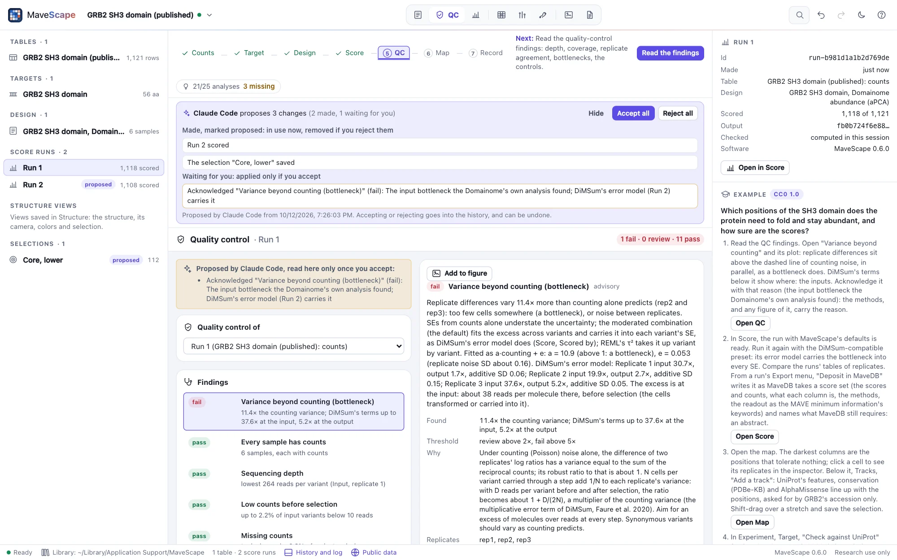
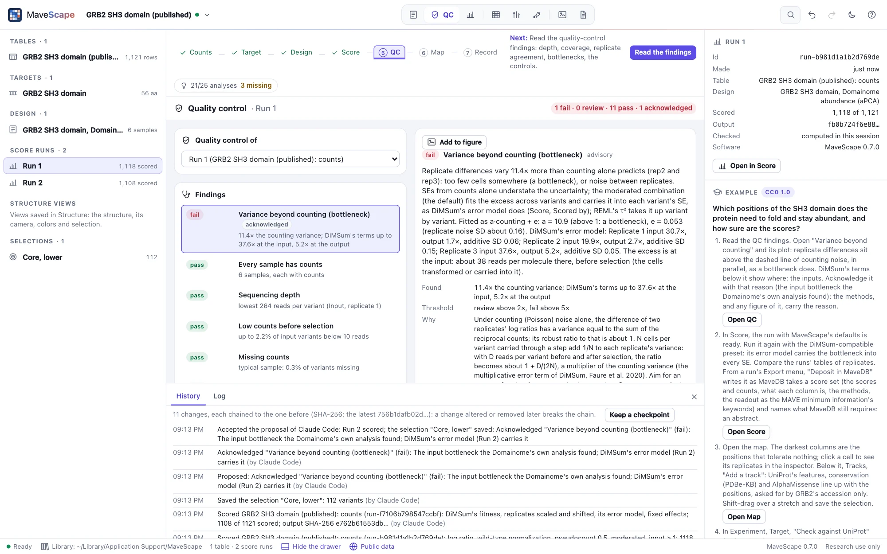

# Using MaveScape with AI agents (MCP)

`mavescape mcp` is a [Model Context Protocol](https://modelcontextprotocol.io) server. An AI agent
such as Claude Code can use it to open count and score tables, bundled examples and MaveDB score
sets, describe an experiment's design, score it, read its quality control, inspect variants and
the map, select variants by query, compare runs, score sets and predictors, check a conclusion's
robustness, show the scores on a protein structure, make figures, write the methods, keep
checkpoints, certify the analysis and export files.

The agent works in the MaveScape window you see. Its changes are proposals: you accept or reject
them there, and each is recorded in the workspace's history with the agent's name.

<picture>
  <source media="(prefers-color-scheme: dark)" srcset="images/agent-proposal-dark.webp">
  
</picture>

- [Requirements](#requirements)
- [Claude Code](#claude-code)
- [Claude Desktop](#claude-desktop)
- [Other clients](#other-clients)
- [Options](#options)
- [Checking the connection](#checking-the-connection)
- [What to ask](#what-to-ask)
- [Tools](#tools)
- [Proposals](#proposals)
- [Files](#files)
- [Scripts without an agent](#scripts-without-an-agent)
- [Privacy and security](#privacy-and-security)
- [Troubleshooting](#troubleshooting)
- [How it works](#how-it-works)

## Requirements

- MaveScape 0.7.0 or later (`mavescape --version`).
- Chrome, Edge, Brave or Chromium for the window (any modern browser works if you open the address
  MaveScape prints yourself).
- The full path to the program. Agents often start programs without your shell's `PATH`; the
  installers put MaveScape in `~/.local/bin/mavescape` (macOS and Linux) or
  `%LOCALAPPDATA%\Programs\MaveScape\mavescape.exe` (Windows).

## Claude Code

```bash
claude mcp add mavescape -- ~/.local/bin/mavescape mcp
```

`--scope user` (after `add`) makes it available in every project, not this one only. On Windows:
`claude mcp add mavescape -- "%LOCALAPPDATA%\Programs\MaveScape\mavescape.exe" mcp`. `claude mcp
list` shows whether it connects, and `/mcp` in a session lists MaveScape's tools.

## Claude Desktop

Add the server to `claude_desktop_config.json` (on macOS in `~/Library/Application Support/Claude/`,
on Windows in `%APPDATA%\Claude\`; Settings, Developer, Edit Config opens it), with the full path
to the program, and restart Claude Desktop:

```json
{
  "mcpServers": {
    "mavescape": {
      "command": "/Users/you/.local/bin/mavescape",
      "args": ["mcp"]
    }
  }
}
```

## Other clients

Any client that starts an MCP server on stdio can use MaveScape: the command is the program's full
path and the arguments are `mcp` and its options. For example:

- Cursor, in `~/.cursor/mcp.json` (or a project's `.cursor/mcp.json`): the same `mcpServers` entry
  as Claude Desktop's.
- VS Code, in a project's `.vscode/mcp.json`:

  ```json
  { "servers": { "mavescape": { "type": "stdio", "command": "/Users/you/.local/bin/mavescape", "args": ["mcp"] } } }
  ```

- OpenAI's Codex CLI, in `~/.codex/config.toml`:

  ```toml
  [mcp_servers.mavescape]
  command = "/Users/you/.local/bin/mavescape"
  args = ["mcp"]
  ```

## Options

Options go after `mcp`, as for `mavescape` itself: `--window app|browser|none` (how the window
opens when a tool first needs it, and again if it was closed; with `none`, open the address
MaveScape prints on stderr), `--port` (8820 by default; the next free one is used), `--data-dir`
(the workspace library), `--offline` or `--no-fetch` (public data from the cache only, or none;
[NETWORK.md](NETWORK.md)) and `--proteoscope off`. A MaveScape you already run is not used: the
agent gets a MaveScape of its own, with its own window, on the same library.

## Checking the connection

Without a client, one message on stdin shows that MaveScape answers as an MCP server (and it stops
when the input ends):

```bash
printf '%s\n' '{"jsonrpc":"2.0","id":1,"method":"initialize","params":{"protocolVersion":"2025-06-18","capabilities":{},"clientInfo":{"name":"check","version":"1"}}}' | ~/.local/bin/mavescape mcp --window none
```

The answer is one line of JSON naming the server (`"name":"mavescape"`), its version and its
instructions to the agent; MaveScape's banner is on stderr.

## What to ask

The agent starts with `get_state` and works in the window as you would. For example:

> Open the GRB2 SH3 example. What does its quality control say, and does the variance beyond
> counting change how far I can trust the scores?

> Score it again with the DiMSum-compatible preset and compare the two runs. Which variants change
> class, and why?

> Which positions of the domain tolerate no substitution? Show them on PDB 2VWF, and make a figure
> of the map and the structure.

> Give me the twenty lowest missense scores of Run 1 with their 95% intervals, as a table.

> Write the methods, keep a checkpoint, and certify the workspace once I have accepted your
> proposals.

The website's [session on Hsp90](https://robert-mcdermott.github.io/MaveScape/docs/scripting.html#session)
shows one through: an agent compares the example's scores with the published ones, finds the time
courses' fit failing, keeps a checkpoint and proposes a design that fits the first three samples,
waits for it to be accepted, scores, and reads what moved as a sensitivity analysis rather than a
fix. Its tool calls are real, and `validation/agent-session.mjs` checks every number its answers
quote.

## Tools

The tools are MaveScape's remote-control actions, under the same names, with the same arguments
(`GET /api/remote/tools` lists them, and the agent's client shows each one's description). Each
carries MCP's hints: whether it only reads (it may still show something in the window), whether it
replaces or removes something, and whether it may ask a public service (MaveDB, UniProt, PDBe, the
PDB, AlphaFold DB) through the program.

| Area | Tools |
| --- | --- |
| The workspace and data | `get_state` (start here), `new_workspace`, `open_example`, `open_files`, `search_mavedb`, `open_mavedb`, `check_target`, `set_mode`, `focus` |
| Design and scoring | `draft_design`, `set_design`, `check`, `score`, `reproduce_run` |
| Quality control | `qc_findings`, `acknowledge_finding`, `set_qc_thresholds` |
| Results | `inspect_variant`, `scores` (a run's variants as a table), `provenance`, `render_map` (in words, and with `image` as a picture), `select_variants`, `compare`, `check_robustness` |
| Tracks beside the map | `list_tracks`, `add_track`, `set_track`, `remove_track` |
| Structures | `find_structures`, `open_structure`, `map_structure`, `set_structure`, `render_structure` (the view as a picture), `structure_evidence`, `save_structure_view`, `open_structure_view`, `remove_structure_view`, `proteoscope_link` |
| Calibration, for research | `make_control_set` (variants of known effect, from ClinVar or a table of labels), `control_sets` (their composition, what a run measured of them, what may make them circular), `remove_control_set`; `calibrate` (a run's scores against a control set: ROC and precision–recall with intervals, thresholds and the functional classes they make, sensitivity and specificity, each class's OddsPath and evidence strength for research, score-level likelihood ratios as acmgscaler computes them, or a MaveDB record's published thresholds with `published`), `calibrations`, `remove_calibration` |
| Figures | `figures` (with `image`, each page as a picture), `create_figure`, `add_figure_panel`, `set_figure`, `export_figure`, `check_figure` |
| The record | `report`, `checkpoint`, `diff`, `certify`, `review_report`, `verify_certificate`, `export`, `mavedb_deposit`, `set_mavedb_details` |
| Proposals | `proposals` (what waits for you, and what you decided) |

The tools MaveScape's product requirements name, and the tool that does each:

| Named in the requirements | MaveScape's tool |
| --- | --- |
| `open_dataset` | `open_files`, or `open_example` |
| `fetch_mavedb` | `search_mavedb` and `open_mavedb` |
| `describe_experiment` | `get_state` |
| `configure_design` | `draft_design` and `set_design` |
| `run_qc`, `list_qc_findings` | `qc_findings` |
| `run_scoring` | `score` |
| `compare_runs` | `compare` |
| `select_variants`, `inspect_variant` | the same |
| `create_figure` | `create_figure` and `add_figure_panel` |
| `export_results` | `export` |
| `write_methods` | `report` |
| `render_structure` | the same |

A result is the action's sentence and its data: as text (the data's JSON after the sentence) and as
structured content. An action MaveScape refuses is a tool error carrying its reason ("p.Trp999Ala
is not in Run 1"), which the agent can act on.

**Tables.** `scores` gives a run's variants as rows with the columns of its scores export
(`scores.csv`: the variant, score, SE, 95% interval, status and why filtered, flags, class, each
replicate's score and SE), a contrast's differential scores, or a nucleotide run's scores at the
protein level; numbers as numbers, `null` where the export has `NA`. It takes the variants at
positions, of kinds, in a saved selection or matching a query of the selection language, sorted by
a column, 100 rows at a time (`offset` for the next; `limit: 0` for all). `provenance` gives what a
run's `provenance.json` holds.

**Pictures.** `render_map` with `image` (the map as its SVG export draws it, at `scale`, positions
`from` to `to`), `render_structure` (the Structure view with its legend) and `figures` with `image`
(each page as `export_figure` writes it, at `dpi`) give PNGs. The agent receives each as an image
after the text, captioned, and the data names it by its number; a script gets it as a data URL
(`data:image/png;base64,…`). The pictures of one result are limited to 8 MB in all.

Scores are research evidence of a variant's functional effect in its assay. MaveScape never calls a
variant pathogenic or benign, and its instructions to the agent say so.

## Proposals

An agent's changes are proposals, which you accept or reject in the window, in the strip above the
view: who proposes how many changes, the list (**Review**), **Accept all** and **Reject all**. Each
decision is in the history, and can be undone. (The picture at the top shows Claude Code's
proposal on the GRB2 example, reviewed: a run scored again and a selection, made at once and
marked proposed; the acknowledgement of a QC finding, waiting.)

- **Made at once, marked proposed**, so that the agent and you can use them meanwhile: tables and
  targets it opens into your workspace, runs it scores, selections it saves, tracks it adds beside
  the map, structure views it saves, figures it makes and panels it adds to yours, analyses it keeps
  in the report, checkpoints. The views mark them *proposed*. Rejecting removes them, with what was
  built on them since (a selection of a run, the figure panels showing it); MaveScape asks before
  removing anything of yours.
- **Held until you accept**: a design it sets or drafts (the Experiment view shows it beside yours,
  and how they differ; the agent scores only once you have accepted it), QC thresholds and
  acknowledgements (shown in the QC view), a target's check against UniProt applied, the MaveDB
  details, and every removal (the views strike out what it would remove).
- **Not proposals**: opening a workspace (`new_workspace`, `open_example`, a MaveDB score set opened
  as its own workspace), what the window shows (the view, the map's coloring, the structure's
  style, the selected variants, the tracks' order), and exports, which write only to the path given
  and change nothing in the analysis.

Changing or removing what it proposed itself applies at once: it is still part of its proposal.
`proposals` tells the agent what is open and what you decided; a tool's result says when what it
did waits for you. Nothing is certified while a proposal is open: `certify` and `review_report`
refuse, saying which.

Every change goes into the workspace's history with the agent's name (the name its MCP client
gives, such as Claude Code); a held change is a *proposed* entry until you accept it, then the
change itself, under the agent's name, followed by your decision. The history's entries are
hash-chained, and the name is part of what each entry's hash covers. The report's decision log
names the agent beside each change it made, and its *AI agents* section says what agents proposed
and you accepted; a checkpoint's diff names who proposed what was added.

What the window commits while an agent's action runs counts as the agent's: the window performs one
action at a time (most take less than a second), and the strip says when an agent is working.

<picture>
  <source media="(prefers-color-scheme: dark)" srcset="images/agent-accepted-dark.webp">
  
</picture>

## Files

`open_files`, `verify_certificate`, `check_figure` and `diff` read files by absolute path; `export`,
`export_figure`, `certify` and `review_report` write them. A file is written only to the absolute
path given, in a folder that exists, through a temporary file renamed into place, and an existing
file is never replaced unless the call passes `overwrite: true`.

## Scripts without an agent

A script's changes are not proposals: you wrote it, and they apply as yours do (the window's log
names the script). The R and Python packages in [`clients/`](../clients/) make each action a
function (`ms_scores()`, `ms.scores()`), with tables as data frames and pictures as files.
`mavescape --remote-control` accepts the same actions from programs on this computer: post JSON
such as `{"action": "score", "args": {"preset": "enrich2"}, "client": "My pipeline"}` to
`/api/remote/action`, with the token MaveScape prints (and writes to `remote.json` in its data
folder) for actions that read or write files. See
[Agents and scripts](https://robert-mcdermott.github.io/MaveScape/docs/scripting.html).

## Privacy and security

- Everything runs on this computer: MaveScape answers only requests from this computer, and your
  tables never leave it. Public data are fetched only from the services listed in
  [NETWORK.md](NETWORK.md), and never with your data.
- The agent acts through the window you use; nothing happens out of sight, its changes wait for
  your decision as above, and every change can be undone.
- Reading and writing files by path is open to the agent connected over stdio, which you started,
  and to scripts that hold the token (in `remote.json`, readable by you only).

## Troubleshooting

- **The client shows no MaveScape tools**: it could not start the program. Give the full path (the
  client may not use your shell's `PATH`), check that `mavescape --version` says 0.7.0 or later,
  and try the [check above](#checking-the-connection). Claude Code's `claude mcp list` and Claude
  Desktop's logs say why a server did not start.
- **No window opens**: MaveScape opens one when a tool first needs it. With `--window browser` it
  opens in your default browser; with `--window none`, open the address on MaveScape's stderr (in
  the client's logs). A window you close is opened again by the next tool that needs one.
- **The agent says something waits for you**: a design, an acknowledgement, QC thresholds, a
  target's check, MaveDB details or a removal it proposed; accept or reject it in the strip above
  the view. `score` waits for a design it proposed; `certify` and `review_report` wait for every
  proposal to be decided.
- **A file was not written**: give an absolute path in a folder that exists; an existing file is
  replaced only with `overwrite: true`.

## How it works

`mavescape mcp` starts MaveScape with remote control on and speaks JSON-RPC on its stdin and stdout,
one message per line (protocol versions 2024-11-05 to 2025-11-25); its banner and logs go to
stderr. A tool call becomes an action that the program forwards to the open window over
Server-Sent Events; the window performs it with the same code as its own controls and posts the
result back, its pictures turned into MCP images. Actions reach the window one at a time. What the
action commits passes through the proposals (`web/lib/proposals.js`), which mark what it makes and
hold what must wait for you. A call that takes long (scoring a large table, a robustness check, a
certificate) reports progress while it runs, and the agent may cancel it. When the agent closes
stdin, MaveScape stops.

The tools, their arguments and hints are `actions.go`'s, the same list scripts and the
[R and Python clients](../clients/) use; `validation/agent-session.mjs` calls every one over stdio
as an agent's client does, and checks what each returns against Node and the window.
